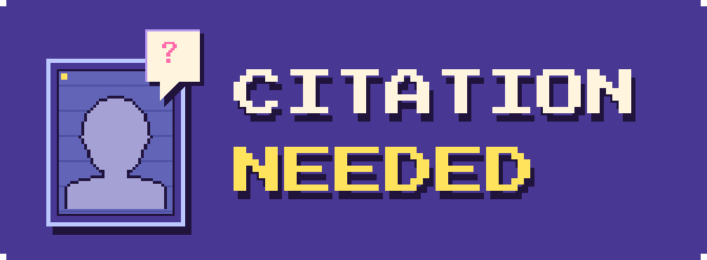

<div align="center">

<a href="https://citation.party"></a>

[](https://citation.party)
[](https://github.com/MaeglynD/citation/actions/workflows/ci.yml)
[](https://www.typescriptlang.org/)
[](md/DEPLOYMENT.md)

**[Play the game](https://citation.party)** · [Run locally](#run-locally) · [Development](md/DEVELOPMENT.md) · [Report an issue](https://github.com/MaeglynD/citation/issues)

</div>


## The game (vibe coded w/ astra)

Read a quote, meet the suspects, and pick its unlikely source. Ten rounds later, revisit your spectacular deductions—and spectacular mistakes (with citations for every answer)

- **689 quotes.** Historical figures, fictional characters and people you probably weren't expecting. A curated opening puts the strongest surprises first.
- **A cast of 914.** A pixel portrait for every answer and decoy, with springy cards, confetti and expressive reveals.
- **Sound with character.** Original interface sounds, chattering dialogue and a playful soundtrack.
- **Your own pace.** No timer. Play with a mouse, keyboard or touch; keep your past games in the browser.
- **Straight into the game.** No account, backend or API key required.

## Run locally

Use **Node.js 22+** and npm.

```sh
git clone https://github.com/MaeglynD/citation.git
cd citation
npm ci
npm run dev
```

Open the local address Vite prints. For a production build:

```sh
npm run build
npm run preview
```

The complete site builds into `dist/`.

## Controls

| Action | Mouse / touch | Keyboard |
| :--- | :--- | :--- |
| Meet a suspect | Hover; tap once on touch | Arrow keys or Tab |
| Pick an answer | Click; tap again on touch | 1–4 |
| Finish the typing | Click | Space |
| Next quote | Click after the reveal | Enter or Space |
| Review your answers | Click a numbered portrait | Arrow keys |
| Main menu | Menu | Home |
| Settings / music on or off | Top-right buttons | S / M |
| Color scheme | Swatches in Settings | T next / Shift+T previous |

The theme swatches run left to right: Midnight, Arcade, Ember, Parchment, with Midnight as the default. Your choice is saved. T and Shift+T also cycle through them. The speaker button silences only the soundtrack; dialogue and effects stay on. Volume controls all audio, with zero silencing everything.

Audio begins after the first click, tap or keypress. Scores, settings and the latest 50 games stay in your browser's local storage.

## Under the hood

**React · TypeScript · Three.js · React Three Fiber · Zustand · Web Audio · Vite**

The entire game is rendered as a low-resolution WebGL scene. Pixel portraits, dialogue, controls and reactions share the same visual grid; the layout adapts for phones and larger screens.

```sh
npm test             # Quote integrity, deck selection, scoring data and saved games
npm run build        # TypeScript checks and production build
```

GitHub Actions checks pushes to `main` and pull requests. Cloudflare serves the production build at **[citation.party](https://citation.party)**; see the [deployment guide](md/DEPLOYMENT.md) for Git integration and manual releases.

[Development notes](md/DEVELOPMENT.md) cover the project structure, browser tests, audio pipeline and quote data.

## Quotes & credits

Every answer includes a source in the game overview and History. Found a shaky attribution? [Open an issue](https://github.com/MaeglynD/citation/issues/new) with the quote and a better source. Research records and editorial corrections live in [`research/`](research/).

The soundtrack uses edited, project-supplied Suno recordings; interface sounds and the fallback score use Web Audio. [Audio credits](public/audio/credits.json) record the source files and edits. Font license notices are included in [`public/fonts/licenses/`](public/fonts/licenses/).
